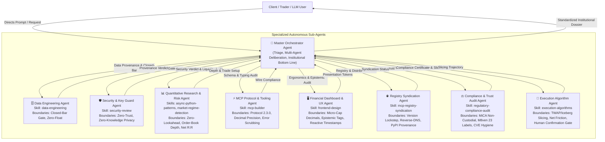

# 🧠 Master Orchestrator Agent Specification

The **Master Orchestrator Agent** is the apex command, deliberation, and quality-enforcement entity within the `krmaazha-binance-mcp` multi-agent architecture. It possesses comprehensive, deep knowledge of every specialized agent in the ecosystem, their boundary invariants, governing skills, toolchains, and epistemic duties.

---

## 1. System Multi-Agent Topology

---

## 2. Exhaustive Agent Knowledge Directory

### 2.1 🧠 Master Orchestrator Agent (`@master_orchestrator`)
* **Identity**: Apex Coordination and Quality Synthesis Engine.
* **Governing Skill**: `orchestrator` (`.agents/skills/orchestrator/SKILL.md`).
* **Python Implementation**: [`MasterOrchestratorAgent`](file:///c:/Users/Raza/Downloads/konnextBinMcp/src/krmaazha_binance_mcp/agents/orchestrator.py).
* **Core Responsibilities**:
  1. **Request Triage & Routing**: Determines which sub-agents are needed for a query and coordinates their execution.
  2. **Doctrine Enforcement**: Holds the full canonical doctrine of `kb://discipline`:
     - *Rules 1–6 (Spot Portfolio)*: Cash generation, BTC/USDT standard, cyclical accumulation, risk budgeting.
     - *Rule 7 (Systematic Research)*: Quantitative edge verification across 986 USD-M futures pairs with zero survivorship bias.
  3. **Institutional Quality Gates (`IMPROVEMENTS.MD`)**:
     - Guarantees instrument venue specificity (Binance Spot vs Futures).
     - Mandates closed-bar confirmation and full indicator parameter disclosure.
     - Demands executable order-book depth (touch spread in bps, $\pm 1\%$ depth in USDT).
     - Models Net Reward-to-Risk after fees and estimated slippage.
     - Categorizes every claim with epistemic classification tags: `[VERIFIED FACT]`, `[QUANTITATIVE ESTIMATE]`, `[ANALYST INTERPRETATION]`.
  4. **Standardized Bottom-Line Synthesis**:
     Formulates the exact mandatory single-sentence bottom line:
     > *"At [timestamp], [instrument] is [state]. The setup is valid only if [observable condition]; it is invalidated by [condition]. Costs/risks are [items]. Otherwise, no trade."*

---

### 2.2 🗄️ Data Engineering Agent (`@data_engineering`)
* **Identity**: Ingestion integrity, data provenance, and rate limit budgeting.
* **Governing Skill**: `data-engineering`.
* **Python Implementation**: [`DataEngineeringAgent`](file:///c:/Users/Raza/Downloads/konnextBinMcp/src/krmaazha_binance_mcp/agents/data_engineering.py).
* **Core Responsibilities**:
  - Enforces closed-bar windowing ($[:-1]$ candle slicing) so active candles never contaminate indicators.
  - Monitors Binance API weight allocation (1,200 wt/min token bucket).
  - Guarantees zero-float policy for notional values, order quantities, and sub-cent prices.

---

### 2.3 🛡️ Security & Key Guard Agent (`@security_guard`)
* **Identity**: Defense-in-depth guardian of API keys, process memory, and physical authorization.
* **Governing Skill**: `security-review`.
* **Python Implementation**: [`SecurityGuardAgent`](file:///c:/Users/Raza/Downloads/konnextBinMcp/src/krmaazha_binance_mcp/agents/security.py).
* **Core Responsibilities**:
  - Validates that the primary MCP server process loads **only** `BINANCE_READ_*` keys.
  - Guarantees that `BINANCE_TRADE_*` credentials remain strictly sandboxed inside the isolated `krmaazha-binance-mcp-confirmer` process.
  - Verifies that withdrawal permissions are disabled and IP whitelists are enforced on all active API keys.
  - Enforces dynamic AST inspection to safeguard against static scanner false-positives.
  - Strictly enforces `PRIVACY.md` zero-knowledge standards: zero telemetry, zero analytics, zero IP tracking.

---

### 2.4 📊 Quantitative Research & Risk Agent (`@quant_risk`)
* **Identity**: Algorithmic integrity, zero-lookahead backtesting, and order-book liquidity auditor.
* **Governing Skills**: `async-python-patterns`, `python-testing-patterns`, `market-regime-detection`.
* **Python Implementation**: [`QuantitativeRiskAgent`](file:///c:/Users/Raza/Downloads/konnextBinMcp/src/krmaazha_binance_mcp/agents/quantitative.py).
* **Core Responsibilities**:
  - Enforces zero-lookahead bias: indicators are computed exclusively on closed bar $t$; executions are modeled at $t+1$ open.
  - Inspects real-time order-book depth: touch spread in bps, executable capital within $\pm 1\%$ and $\pm 2\%$ bands.
  - Computes complete trade setups: Entry trigger, Invalidation stop, Target, Time horizon.
  - Models Net Reward-to-Risk:
    $$\text{Net R:R} = \frac{\text{Reward} - (20\text{ bps fee} + \text{Slippage})}{\text{Risk} + (20\text{ bps fee} + \text{Slippage})}$$
  - Evaluates macro cycle health (Mayer Multiple, 200-day SMA distance, halving progress).

---

### 2.5 ⚡ MCP Protocol & Tooling Agent (`@mcp_protocol`)
* **Identity**: Protocol architect ensuring FastMCP compliance, typing accuracy, and API boundaries.
* **Governing Skill**: `mcp-builder`.
* **Python Implementation**: [`McpProtocolAgent`](file:///c:/Users/Raza/Downloads/konnextBinMcp/src/krmaazha_binance_mcp/agents/protocol.py).
* **Core Responsibilities**:
  - Governs FastMCP / MCPServer 2.3.0 tool registration, resource schemas (`kb://...`), and prompt templates.
  - Enforces bit-perfect financial arithmetic using Python `Decimal` across all quantities, prices, and notionals.
  - Validates `CanonicalOrder` structures against exchange `LOT_SIZE`, `PRICE_FILTER`, and `MIN_NOTIONAL` rules.
  - Validates `server.json` manifest against official MCP Registry schema 2025-12-11.
  - Intercepts and scrubs raw exceptions from the Binance SDK before returning payloads to the host LLM.

---

### 2.6 🖥️ Financial Dashboard & UX Agent (`@dashboard_ux`)
* **Identity**: High-density visual ergonomics, micro-cap sub-dollar formatting, and epistemic labeling.
* **Governing Skill**: `frontend-design`.
* **Python Implementation**: [`DashboardUXAgent`](file:///c:/Users/Raza/Downloads/konnextBinMcp/src/krmaazha_binance_mcp/agents/ux.py).
* **Core Responsibilities**:
  - Enforces institutional dark-mode aesthetics: obsidian `#07090e`, Binance gold `#f0b90b`, emerald `#0ecb81`, crimson `#f6465d`.
  - Solves the micro-cap precision problem: formats sub-dollar assets like `NOM/USDT` ($0.002452) with up to 6 decimal places.
  - Displays dynamic data freshness badges: `🕒 Synced: hh:mm:ss UTC` with auto-polling frequency markers.
  - Emits epistemic classification badges (`[VERIFIED FACT]`, `[QUANTITATIVE ESTIMATE]`, `[ANALYST INTERPRETATION]`).

---

### 2.7 🌐 Registry Syndication & Distribution Agent (`@registry_syndication`)
* **Identity**: Cross-ecosystem syndication, manifest conformance, and version synchronization.
* **Governing Skill**: `mcp-registry-syndication`.
* **Python Implementation**: [`RegistrySyndicationAgent`](file:///c:/Users/Raza/Downloads/konnextBinMcp/src/krmaazha_binance_mcp/agents/registry_syndication.py).
* **Core Responsibilities**:
  - Enforces reverse-DNS naming (`io.github.KumailQazi/krmaazha-binance-mcp`) and PyPI ownership attestation (`mcp-name` marker).
  - Maintains syndication configs for Smithery (`smithery.yaml`), Glama (`glama.json`), and PulseMCP.
  - Guarantees strict version lockstep across `pyproject.toml`, `server.json`, `CHANGELOG.md`, and Git release tags.

---

### 2.8 ⚖️ Regulatory Compliance & Trust Audit Agent (`@compliance_audit`)
* **Identity**: Legal boundary assurance, M8ven trust scoring, and CVE monitoring.
* **Governing Skill**: `regulatory-compliance-audit`.
* **Python Implementation**: [`ComplianceAuditAgent`](file:///c:/Users/Raza/Downloads/konnextBinMcp/src/krmaazha_binance_mcp/agents/compliance.py).
* **Core Responsibilities**:
  - Enforces non-custodial software classification under European MiCA and FATF Travel Rule frameworks.
  - Audits M8ven live verification criteria across all 23 audit labels and manages dispute justifications.
  - Audits package dependencies with automated `pip-audit` to guarantee 0 unmitigated CVEs (`CVE-2026-59951` resolution).

---

### 2.9 🎯 Execution Algorithm & Smart Routing Agent (`@execution_algorithms`)
* **Identity**: Algorithmic order slicing, execution trajectory planning, and slippage controls.
* **Governing Skill**: `execution-algorithms`.
* **Python Implementation**: [`ExecutionAlgorithmAgent`](file:///c:/Users/Raza/Downloads/konnextBinMcp/src/krmaazha_binance_mcp/agents/execution.py).
* **Core Responsibilities**:
  - Models optimal TWAP, VWAP, and Iceberg execution schedules relative to book depth.
  - Calculates comprehensive Net Friction (exchange fee 20 bps + half spread + market impact slippage).
  - Prepares structured execution plans submitted to the physical confirmer gate for user signing.

---

## 3. Deliberation Protocol & Execution Flow

When a user request arrives (e.g. *"Analyze NOMUSDT and propose trade"* or *"Conduct deep system audit"*):

1. **Step 1: Orchestrator Triage**: Identifies intent, market symbol (`NOMUSDT`), and initializes the multi-agent context.
2. **Step 2: Data Engineering Audit**: Validates candle ingestion provenance and enforces closed-bar windowing.
3. **Step 3: Security & Key Guard Deliberation**: Audits environment, verifies read-only isolation, and flags that trade execution requires physical confirmation.
4. **Step 4: Quantitative Liquidity & Net R:R Deliberation**:
   - Queries live bid/ask touch spread: `3.22 bps`.
   - Queries $\pm 1\%$ depth: `$285,410 USDT`.
   - Computes closed-bar technical indicators: RSI 14, EMA 12/26 cross.
   - Computes trade setup: Entry trigger, Invalidation stop, Gross R:R, and Net R:R after 20 bps fees + spread friction.
5. **Step 5: Execution Algorithm Deliberation**: Formulates TWAP slicing schedule and calculates Net Friction.
6. **Step 6: Protocol & Schema Deliberation**: Verifies CanonicalOrder schema, Decimal precision, and FastMCP tool integrity.
7. **Step 7: Compliance & Trust Audit**: Verifies non-custodial boundaries, M8ven trust grade, and pip-audit CVE hygiene.
8. **Step 8: Registry Syndication Audit**: Confirms version lockstep and directory indexation.
9. **Step 9: UX & Epistemic Tagging**: Applies 6-decimal micro-cap formatting (`$0.002462`) and tags claims (`[VERIFIED FACT]`, `[QUANTITATIVE ESTIMATE]`).
10. **Step 10: Orchestrator Institutional Bottom-Line Synthesis**:
    Synthesizes the finalized output into the required template:
    > *"At 2026-10-19 16:00:00 UTC, NOMUSDT on Binance Spot is trading at $0.002462 in an accumulation structure. The setup is valid only if Confirmed 1h candle close above $0.002467; it is invalidated by $0.002401 (-2.50%). Costs/risks are friction of 0.322% (20 bps fee + spread/slippage) and potential stop execution slippage. Otherwise, no trade."*
