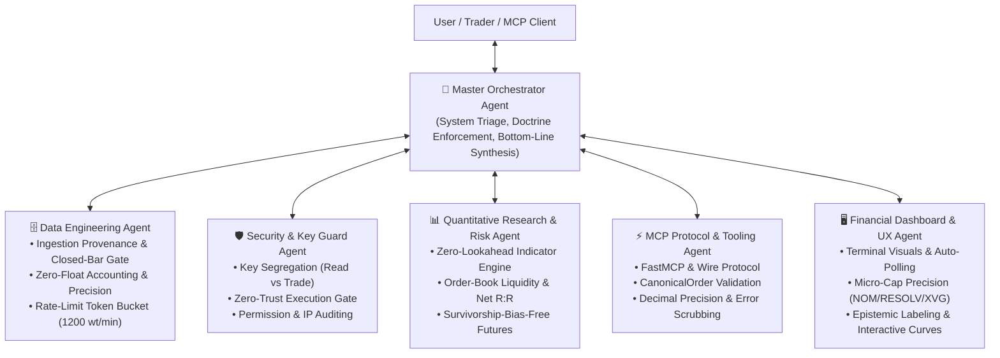

# Multi-Agent Architecture & Master Orchestrator: Krmaazha Binance MCP

This repository operates as an intelligent multi-agent system combining specialized autonomous roles under the command of a **Master Orchestrator Agent**.

---

## 1. The Master Orchestrator Agent (`@orchestrator`)

### Core Responsibility
The Master Orchestrator is the apex decision and coordination agent. It holds deep knowledge of all 5 sub-agents, their exact tool dependencies, permission boundaries, and operational skills. It is responsible for:
1. **Request Triage & Sub-Agent Routing**: Dispatches tasks to the right specialist(s) and coordinates sequential execution.
2. **Doctrine Enforcement**: Guarantees all outputs adhere to `kb://discipline` (Rules 1–6 spot portfolio, Rule 7 systematic research).
3. **Institutional Standards (`IMPROVEMENTS.MD`)**:
   - Enforces exact instrument identification (venue, market type, ISO 8601 UTC timestamp).
   - Validates that signals include closed-bar confirmation, indicator parameters, and input data traceability.
   - Converts naked price levels into full trade setups with **Net R:R** (after fees, spread, and slippage).
   - Mandates epistemic tags (`[VERIFIED]`, `[ESTIMATED]`, `[OPINION]`).
   - Synthesizes all analysis into the standardized single-sentence bottom line:
     > *"At [timestamp], [instrument] is [state]. The setup is valid only if [observable condition]; it is invalidated by [condition]. Costs/risks are [items]. Otherwise, no trade."*

---

## 2. Specialized Sub-Agent Directory

### 2.1 🗄️ Data Engineering Agent
* **Role**: Ingestion integrity, data provenance, zero-lookahead windowing, pipeline orchestration, and rate budget enforcement.
* **Governing Skills**: `data-engineering`, `data-quality-frameworks`, `dbt-transformation-patterns`, `airflow-dag-patterns`, `spark-optimization`, `sql-optimization-patterns`, `postgresql-table-design`
* **Boundaries**:
  - Validates full instrument traceability (venue, market type, quote asset, UTC timestamp).
  - Guarantees closed-bar windowing ($[:-1]$ slicing) so indicators never consume active candles.
  - Monitors Binance API weight allocation (1200 wt/min token bucket) and triggers backoff before rate limits hit.
  - Enforces zero-float policy for notional values, order quantities, and micro-cap sub-cent prices.

### 2.2 🛡️ Security & Key Guard Agent
* **Role**: Defense-in-depth guardian of credentials and capital safety.
* **Governing Skill**: `security-review` (from Sentry)
* **Boundaries**:
  - The MCP server process (`krmaazha-binance-mcp`) must **only** load `BINANCE_READ_*` keys.
  - The trade key (`BINANCE_TRADE_*`) must strictly live in the separate `krmaazha-binance-mcp-confirmer` process.
  - No automated execution paths may ever bypass the physical confirmation gate.
  - Startup guards abort if the read key can trade or if the trade key has withdrawals enabled or lacks an IP whitelist.

### 2.3 📊 Quantitative Research & Risk Agent
* **Role**: Pure mathematical computation, risk budgeting, systematic backtesting, and algorithmic integrity.
* **Governing Skills**: `async-python-patterns`, `python-testing-patterns`, `backtesting-frameworks`, `risk-metrics-calculation`, `ml-pipeline-workflow`
* **Boundaries**:
  - **Zero-lookahead bias**: Signals computed on closed bar `t` execute at open `t+1`.
  - **Liquidity depth**: Reports touch spread (bps), order-book depth within ±1% and ±2%, and flags thin books.
  - **Cycle tracking**: Computes Mayer Multiple, ATH drawdowns, and halving cycles.
  - **Offline futures research**: Audits 986 USD-M pairs with survivorship bias elimination.

### 2.4 🤖 AI & RAG Engineering Capabilities
* **Role**: Intelligent retrieval, prompt calibration, evaluation harnesses, and synthetic evaluation.
* **Governing Skills**: `rag-implementation`, `llm-evaluation`, `eval-harness-first`, `prompt-engineering-patterns`, `hybrid-search-implementation`, `embedding-strategies`, `vector-index-tuning`, `dataset-curation`, `ai-debt-detector`
* **Boundaries**:
  - Enforces strict evaluation criteria and ground-truth validation for agent reasoning and trade signals.
  - Eliminates AI hallucinations and audit debt through automated evaluation harnesses (`eval-harness-first`).
  - Implements hybrid search (BM25 + dense vectors) for high-precision retrieval over research and market documentation.

### 2.5 ⚡ MCP Protocol & Tooling Agent
* **Role**: Model Context Protocol interface, typing integrity, and API isolation.
* **Governing Skills**: `mcp-builder`, `improve-codebase-architecture`
* **Boundaries**:
  - Strict Python `Decimal` typing for all quantities, prices, and notionals.
  - Restricts IPC wire verbs strictly to `register` and `status` transporting `CanonicalOrder`.
  - Sanitizes all error messages before sending them to the LLM to prevent leaking credentials or internal nonces.

### 2.6 🖥️ Financial Dashboard & UX Agent
* **Role**: Ergonomics, real-time data streaming, and transparent visualization.
* **Governing Skill**: `frontend-design` (from Anthropic)
* **Boundaries**:
  - Delivers high-density terminal aesthetics (obsidian `#07090e`, Binance gold `#f0b90b`, emerald `#0ecb81`).
  - Handles sub-dollar micro-cap price formatting with up to 6 decimal places (`$0.002452` for NOM, RESOLV, XVG).
  - Maintains auto-refresh loops (5s tickers, 15s candles, 30s signals, 60s macro) and displays exact "Last Fetched" timestamps.

---

## 3. Orchestration Workflow Matrix

When a user request arrives, the Master Orchestrator coordinates the agents according to this strict dependency pipeline:

| User Intent | Primary Agent | Supporting Agents | Orchestrator Quality Gate |
|---|---|---|---|
| **Market Analysis / Price Check** | Quantitative Agent | Data Engineering, UX Agent | Validates exact instrument (venue, timestamp), audits ingestion provenance & depth, formats price with micro-cap precision. |
| **Asset Thesis (`/asset_thesis`)** | Quantitative Agent | Security Agent, UX Agent | Enforces `kb://frameworks/token-value`, tags claims `[VERIFIED]`/`[OPINION]`, generates the standardized bottom line. |
| **Order Proposal (`/trade`)** | MCP Protocol Agent | Data Engineering, Security Agent, Quant Agent | Verifies rate limits & book staleness, pre-validates LOT_SIZE / MIN_NOTIONAL, checks touch spread & thin book flags, dispatches to Confirmer gate. |
| **Code Refactor / Tool Add** | MCP Protocol Agent | Security Agent, Data Engineering | Runs `improve-codebase-architecture`, executes `security-review`, verifies `pytest --cov >= 90%`. |
| **Dashboard Enhancement** | UX Agent | Quantitative Agent, Data Engineering | Ensures high-density layout, reactive timestamp sync, verified SSE data stream, and responsive SVG/Canvas charting. |
