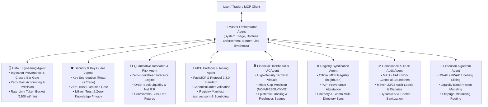

# Multi-Agent Architecture & Master Orchestrator: Krmaazha Binance MCP

This repository operates as an institutional multi-agent system combining eight specialized autonomous roles under the command of the **Master Orchestrator Agent**.

---

## 1. The Master Orchestrator Agent (`@orchestrator`)

### Core Responsibility
The Master Orchestrator is the apex decision and coordination agent. It holds deep operational knowledge of all eight sub-agents, their exact tool dependencies, permission boundaries, and governing skills. It is responsible for:
1. **Request Triage & Sub-Agent Routing**: Dispatches tasks to the right specialist(s) and coordinates sequential or deep parallel execution.
2. **Doctrine Enforcement**: Guarantees all outputs adhere to `kb://discipline` (Rules 1–6 spot portfolio, Rule 7 systematic futures research).
3. **Institutional Standards (`IMPROVEMENTS.MD`)**:
   - Enforces exact instrument identification (venue, market type, ISO 8601 UTC timestamp).
   - Validates that signals include closed-bar confirmation, indicator parameters, and input data traceability.
   - Converts naked price levels into full trade setups with **Net R:R** (after fees, spread, and slippage).
   - Mandates algorithmic execution slicing when order sizes exceed liquidity thresholds.
   - Enforces non-custodial regulatory boundaries and zero-knowledge privacy.
   - Mandates epistemic tags (`[VERIFIED FACT]`, `[QUANTITATIVE ESTIMATE]`, `[ANALYST INTERPRETATION]`).
   - Synthesizes all analysis into the standardized single-sentence bottom line:
     > *"At [timestamp], [instrument] is [state]. The setup is valid only if [observable condition]; it is invalidated by [condition]. Costs/risks are [items]. Otherwise, no trade."*

---

## 2. Specialized Sub-Agent Directory

### 2.1 🗄️ Data Engineering Agent (`@data_engineering`)
* **Role**: Ingestion integrity, data provenance, zero-lookahead windowing, pipeline orchestration, and rate budget enforcement.
* **Governing Skills**: `data-engineering`, `data-quality-frameworks`, `dbt-transformation-patterns`, `airflow-dag-patterns`, `spark-optimization`, `sql-optimization-patterns`, `postgresql-table-design`
* **Boundaries**:
  - Validates full instrument traceability (venue, market type, quote asset, UTC timestamp).
  - Guarantees closed-bar windowing ($[:-1]$ slicing) so indicators never consume active candles.
  - Monitors Binance API weight allocation (1,200 wt/min token bucket) and triggers backoff before rate limits hit.
  - Enforces zero-float policy for notional values, order quantities, and micro-cap sub-cent prices.

### 2.2 🛡️ Security & Key Guard Agent (`@security_guard`)
* **Role**: Defense-in-depth guardian of credentials, privacy, and capital safety.
* **Governing Skill**: `security-review` (from Sentry)
* **Boundaries**:
  - The MCP server process (`krmaazha-binance-mcp`) must **only** load `BINANCE_READ_*` keys.
  - The trade key (`BINANCE_TRADE_*`) must strictly live in the separate `krmaazha-binance-mcp-confirmer` process.
  - No automated execution paths may ever bypass the physical confirmation gate.
  - Dynamic AST inspection guards against false-positive secret leakage detections.
  - Strictly enforces `PRIVACY.md` zero-knowledge standards: zero telemetry, zero analytics, zero IP tracking.

### 2.3 📊 Quantitative Research & Risk Agent (`@quant_risk`)
* **Role**: Pure mathematical computation, risk budgeting, systematic backtesting, and algorithmic integrity.
* **Governing Skills**: `async-python-patterns`, `python-testing-patterns`, `backtesting-frameworks`, `risk-metrics-calculation`, `market-regime-detection`
* **Boundaries**:
  - **Zero-lookahead bias**: Signals computed on closed bar $t$ execute at open $t+1$.
  - **Liquidity depth**: Reports touch spread (bps), order-book depth within $\pm 1\%$ and $\pm 2\%$, and flags thin books.
  - **Cycle tracking**: Computes Mayer Multiple, ATH drawdowns, and halving cycles.
  - **Offline futures research**: Audits 986 USD-M pairs with survivorship bias elimination.

### 2.4 ⚡ MCP Protocol & Tooling Agent (`@mcp_protocol`)
* **Role**: Model Context Protocol interface, typing integrity, registry manifests, and API isolation.
* **Governing Skills**: `mcp-builder`, `improve-codebase-architecture`
* **Boundaries**:
  - Strict Python `Decimal` typing for all quantities, prices, and notionals without scientific notation.
  - Validates official MCP Registry `server.json` manifests against schema 2025-12-11.
  - Restricts IPC wire verbs strictly to `register` and `status` transporting `CanonicalOrder`.
  - Sanitizes all error messages before sending them to the LLM to prevent leaking credentials or internal nonces.

### 2.5 🖥️ Financial Dashboard & UX Agent (`@dashboard_ux`)
* **Role**: Ergonomics, real-time data streaming, and transparent visualization.
* **Governing Skill**: `frontend-design` (from Anthropic)
* **Boundaries**:
  - Delivers high-density terminal aesthetics (obsidian `#07090e`, Binance gold `#f0b90b`, emerald `#0ecb81`).
  - Handles sub-dollar micro-cap price formatting with up to 6 decimal places (`$0.002452` for NOM, RESOLV, XVG).
  - Maintains auto-refresh loops (5s tickers, 15s candles, 30s signals, 60s macro) and displays exact "Last Fetched" timestamps.

### 2.6 🌐 Registry Syndication & Distribution Agent (`@registry_syndication`)
* **Role**: Ecosystem discovery, directory syndication, and distribution packaging.
* **Governing Skill**: `mcp-registry-syndication`
* **Boundaries**:
  - Enforces reverse-DNS naming (`io.github.KumailQazi/krmaazha-binance-mcp`) and PyPI ownership attestation (`mcp-name` tag).
  - Maintains syndication configs for Smithery (`smithery.yaml`), Glama (`glama.json`), and PulseMCP.
  - Guarantees strict version lockstep across `pyproject.toml`, `server.json`, and `CHANGELOG.md`.

### 2.7 ⚖️ Regulatory Compliance & Trust Audit Agent (`@compliance_audit`)
* **Role**: Non-custodial legal guardrails, third-party trust verification, and dependency security.
* **Governing Skill**: `regulatory-compliance-audit`
* **Boundaries**:
  - Enforces non-custodial software classification under European MiCA and FATF Travel Rule frameworks.
  - Audits M8ven live verification criteria across all 23 audit labels and manages dispute justifications.
  - Audits package dependencies with automated `pip-audit` to guarantee 0 unmitigated CVEs (`CVE-2026-59951` resolution).

### 2.8 🎯 Execution Algorithm & Smart Routing Agent (`@execution_algorithms`)
* **Role**: Institutional trade trajectory design, order slicing, and slippage minimization.
* **Governing Skill**: `execution-algorithms`
* **Boundaries**:
  - Models optimal TWAP, VWAP, and Iceberg execution schedules relative to book depth.
  - Calculates comprehensive Net Friction (exchange fee 20 bps + half spread + market impact slippage).
  - Mandates human confirmation gate approval before any sliced order tranche can be signed or submitted.

---

## 3. Orchestration Workflow Matrix

When a user request arrives, the Master Orchestrator coordinates the agents according to this dependency pipeline:

| User Intent | Primary Agent | Supporting Agents | Orchestrator Quality Gate |
|---|---|---|---|
| **Market Analysis / Price Check** | Quantitative Agent | Data Engineering, UX Agent | Validates exact instrument (venue, timestamp), audits ingestion provenance & depth, formats price with micro-cap precision. |
| **Asset Thesis (`/asset_thesis`)** | Quantitative Agent | Security Agent, UX Agent, Compliance Agent | Enforces `kb://discipline`, tags claims `[VERIFIED]`/`[OPINION]`, generates the standardized bottom line. |
| **Order Proposal (`/trade`)** | Execution Algorithm Agent | Security Agent, MCP Protocol Agent, Quant Agent | Models TWAP/Iceberg slicing, pre-validates LOT_SIZE / MIN_NOTIONAL, computes Net Friction, dispatches to physical Confirmer gate. |
| **Registry Publishing / Release** | Registry Syndication Agent | MCP Protocol Agent, Compliance Agent | Enforces version lockstep, validates `server.json` schema, verifies PyPI ownership marker, generates release assets. |
| **Trust & Security Audit** | Compliance Audit Agent | Security Agent, Data Engineering | Audits M8ven 23/23 labels, checks non-custodial boundaries, scans `pip-audit` CVEs, verifies zero-telemetry policy. |
| **Dashboard Enhancement** | UX Agent | Quantitative Agent, Data Engineering | Ensures high-density layout, reactive timestamp sync, verified SSE data stream, and responsive SVG/Canvas charting. |
