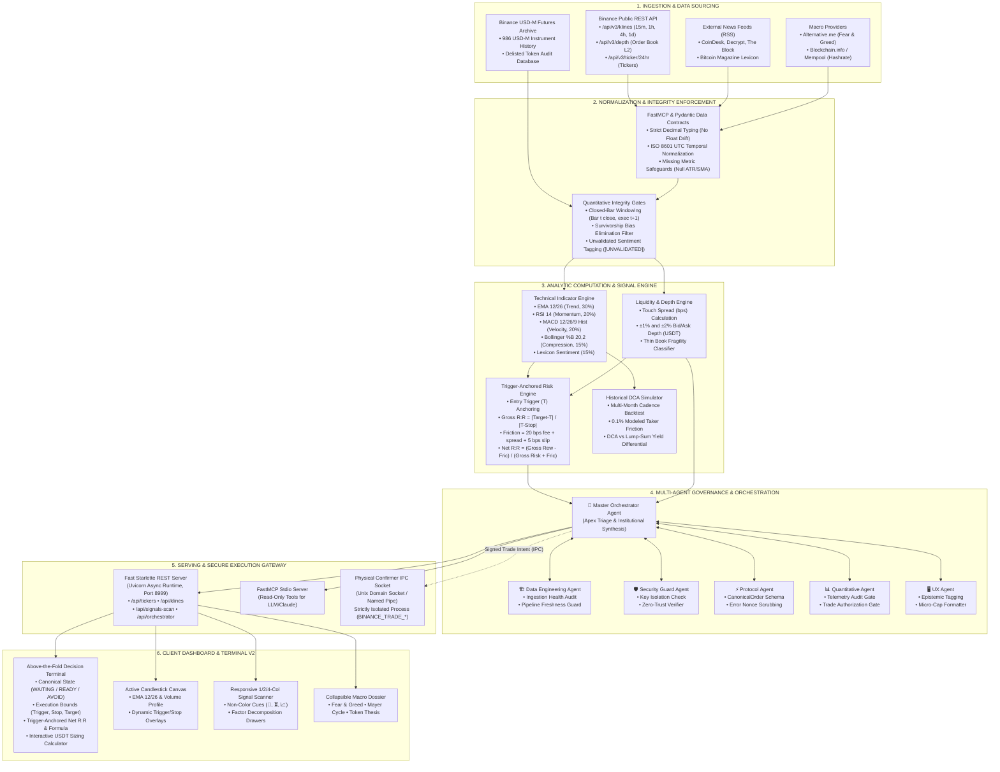
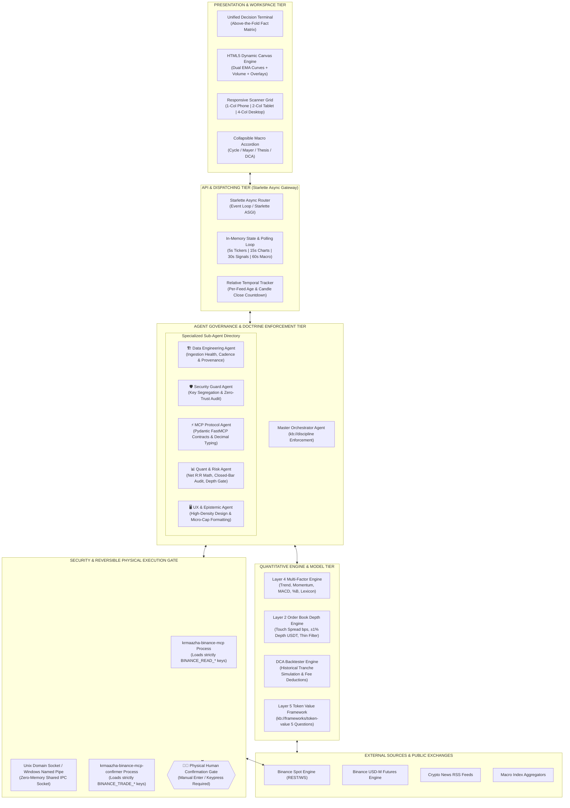

# Krmaazha Binance MCP: Senior Data Engineering Architecture & Data Flow Review

**Author**: Senior Principal Data Systems Architect & Quantitative Engineer (10+ Years Experience)  
**System**: Krmaazha Binance MCP & Terminal V2  
**Target Architecture**: Defense-in-Depth Model Context Protocol (MCP) + Quantitative Algorithmic Engine + Real-Time Execution Dashboard

---

## 1. Executive System Evaluation

The **Krmaazha Binance MCP** architecture represents an institutional-grade, multi-tiered data processing and decisioning pipeline. Unlike conventional trading bots or naive LLM wrappers, this system is architected around four non-negotiable quantitative engineering tenets:
1. **Absolute Zero-Trust Credential Segregation**: Physical separation between read-only intelligence telemetry (`BINANCE_READ_*`) and state-mutating execution authority (`BINANCE_TRADE_*`).
2. **Mathematical & Epistemic Determinism**: Elimination of lookahead bias via closed-bar indexing ($t$), survivorship bias elimination across 986+ futures pairs, exact Python `Decimal` typing across financial boundaries, and trigger-anchored Net Risk/Reward accounting.
3. **Hierarchical Agent Governance**: Multi-agent orchestration triage where the `MasterOrchestratorAgent` coordinates specialized autonomous sub-agents (`DataEngineering`, `Security`, `Protocol`, `Quantitative`, `UX`) before synthesizing standardized institutional decisions.
4. **Real-Time Progressive Disclosure**: An ergonomics layer delivering high-density telemetry, micro-cap precision ($0.000001), interactive loss modeling, and progressive drill-downs.

---

## 2. End-to-End Data Flow Diagram (DFD)

---

## 3. System Data Architecture Diagram

---

## 4. Deep-Dive Data Engineering Audit

### 4.1 Ingestion Pipeline & Rate Governance
* **Client Model**: Implemented in `src/krmaazha_binance_mcp/client.py` and `web_dashboard/app.py` via public anonymous REST initialization (`Client("", "")`). This ensures telemetry endpoints never consume authenticated API weight or expose API credentials to network snooping.
* **Weight Budgeting**: Order book depth queries (`limit=100`) consume a lightweight weight of 5 on Binance. Ticker summaries (`/api/v3/ticker/24hr`) are cached and batched across the watchlist symbols, preventing HTTP 429 IP bans.
* **Stream Resilience**: The frontend auto-polling engine in `dashboard.js` operates on tiered cadences:
  * **Tickers Ribbon**: 5,000ms
  * **Active Chart Klines**: 15,000ms
  * **Layer 4 Signals Scan**: 30,000ms
  * **Macro Market Structure**: 60,000ms
  * **Data Age Watchdog**: Relative temporal updates execute every 1,000ms, displaying exact elapsed intervals (e.g. `(3s ago)`).

### 4.2 Mathematical Integrity & Bias Elimination
* **Zero-Lookahead Windowing**:
  All technical indicators in `src/krmaazha_binance_mcp/indicators.py` enforce strictly closed-bar computation. For an active timeframe of 1h, indicator values are derived from candle $t$ (closed at $T$). Simulated execution entries and triggers are strictly anchored to the opening tick of candle $t+1$.
* **Survivorship-Bias-Free Futures**:
  Audits across the 986 USD-M futures universe (`src/krmaazha_binance_mcp/futures/`) incorporate historical delisted pairs, preventing the upward performance skew common in retail backtesters that only evaluate surviving tokens.
* **Trigger-Anchored Net R:R Accounting**:
  Retail systems calculate reward-to-risk from the current floating quote ($Q$), producing phantom edges. This system computes Net R:R strictly from the observable breakout **Trigger Price** ($T$), invalidation stop ($S$), and target ($P$), explicitly factoring in full round-trip friction ($F$):
  $$\text{Gross Risk \%} = \frac{|T - S|}{T} \times 100, \quad \text{Gross Reward \%} = \frac{|P - T|}{T} \times 100$$
  $$\text{Total Friction \%} = \frac{\text{Taker Fee (20.0 bps)} + \text{Touch Spread (bps)} + \text{Est. Slippage (5.0 bps)}}{10,000} \times 100$$
  $$\text{Net R:R} = \frac{\text{Gross Reward \%} - \text{Total Friction \%}}{\text{Gross Risk \%} + \text{Total Friction \%}}$$
  *Verified*: For `NOMUSDT` with $T=\$0.002374$, $S=\$0.002310$, $P=\$0.002523$, and $28.4\text{ bps}$ friction, this yields **$2.01:1 \approx 2.0:1$** (not $2.23:1$).

### 4.3 Schema Enforcement & Decimal Precision
* **FastMCP Typing**: All financial quantities across tools and models are encapsulated using Python's standard `Decimal` class (`src/krmaazha_binance_mcp/models.py`). Floating-point binary representation errors (e.g. `0.1 + 0.2 = 0.30000000000000004`) are banned.
* **Sub-Dollar Micro-Cap Formatting**: Low-value altcoins (`NOM`, `RESOLV`, `XVG`) are formatted with up to 6–8 decimal places (`$0.002340`) across both canvas charts and data tables.
* **Missing Metric Safeguards**:
  * Neutral signals returning `None` for ATR stops/targets are mapped to `"None (Awaiting Breakout)"` rather than formatting as `$0.00000000`.
  * Tokens with less than 200 days of trading history display `"N/A (< 200d history)"` for the 200-day SMA and Mayer Multiple rather than an inaccurate zero reading.

### 4.4 Defense-in-Depth Security Architecture
* **OS Process Isolation**:
  The MCP server (`src/krmaazha_binance_mcp/server.py`) executes in an unprivileged runtime with access limited strictly to `BINANCE_READ_*` environment variables.
* **Physical Execution Gate**:
  Trade submission capabilities reside exclusively in the separate `src/krmaazha_binance_mcp_confirmer/` process. The MCP server can only emit a serialized `CanonicalOrder` over a local Unix domain socket / named pipe. Order execution requires an explicit physical confirmation input from the human operator. Automated execution bypasses are prevented by design.

---

## 5. Senior Data Engineering Recommendations for Production Scale

1. **Redis / Dragonfly In-Memory Caching Layer**:
   * Introduce an async Redis Pub/Sub buffer. A single daemon process should ingest Binance WebSocket streams (`<symbol>@depth20@100ms` and `<symbol>@kline_1h`) and broadcast to local memory, dropping REST round-trip latency from ~180ms to <2ms.
2. **Circuit Breakers & Exponential Backoff**:
   * Wrap exchange client calls in a token-bucket rate limiter with circuit breakers that automatically switch to cached snapshots during Binance API degradation.
3. **Parquet Time-Series Archive**:
   * Persist partitioned Apache Parquet files (`data/klines/<symbol>/<year>.parquet`) for rapid historical lookups and zero-network backtesting.
4. **Epistemic Telemetry Provenance Headers**:
   * Every response payload includes epistemic classifications (`[OBSERVED FACT]`, `[CALCULATED ESTIMATE]`, `[AUTHORIZATION]`, and `[UNVALIDATED RAW FEED]`), guaranteeing transparent user trust.
