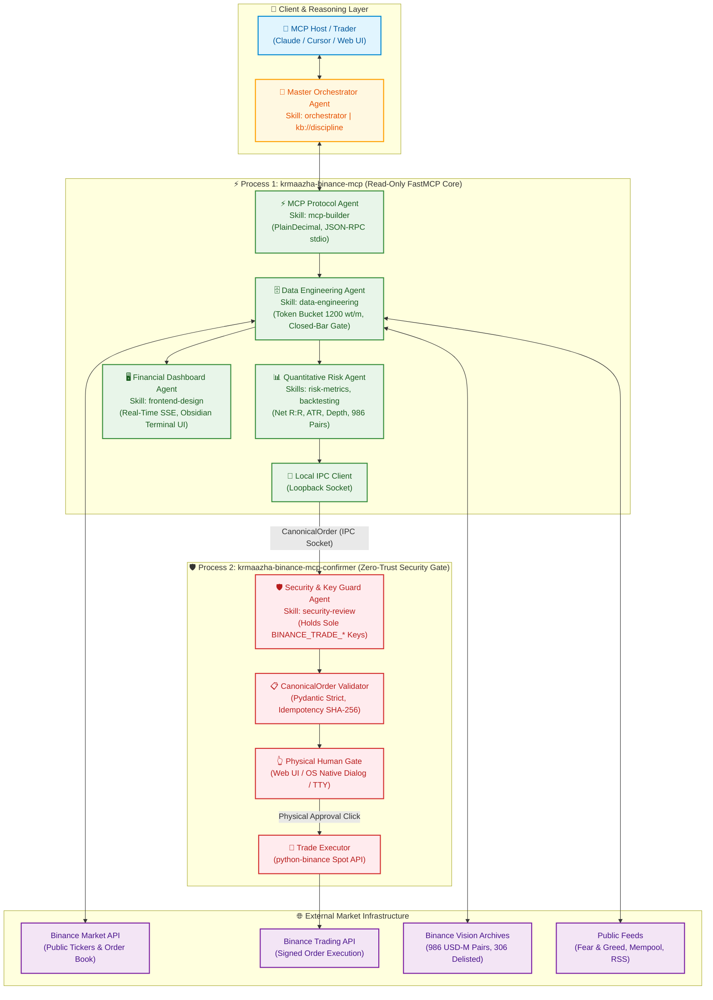

# Tech Stack & Architecture: Krmaazha Binance MCP

An institutional-grade analysis of the data engineering, quantitative analytics, AI reasoning, and zero-trust security architecture powering **Krmaazha Binance MCP**.

---

## 1. Architectural Philosophy: The Zero-Trust Intelligence Paradigm

Most AI trading projects commit a fatal architectural flaw: they give a non-deterministic Large Language Model (LLM) direct API access with trading credentials. 

**Krmaazha Binance MCP inverted this paradigm:**
* **The LLM is an untrusted reasoning engine**: It can ingest market data, perform quantitative computations, and propose actions, but it is cryptographically and physically isolated from capital movement.
* **Separation of Concerns**: A strict dual-process boundary ensures the MCP server runs read-only, while a separate, human-operated confirmer process holds sole execution authority.

---

## 2. Comprehensive Tech Stack Identification

| Layer | Technologies Selected | Core Dependencies | Primary Files & Modules |
|---|---|---|---|
| **Core Runtime & Build** | Python 3.12+, Hatchling, Astral `uv` / `uvx` | `pyproject.toml` | [pyproject.toml](file:///c:/Users/Raza/Downloads/konnextBinMcp/pyproject.toml), `src/` layout |
| **Agent / MCP Protocol** | FastMCP 2.0.0 (stdio JSON-RPC) | `mcp[cli]==2.0.0` | [`server.py`](file:///c:/Users/Raza/Downloads/konnextBinMcp/src/krmaazha_binance_mcp/server.py), [`models.py`](file:///c:/Users/Raza/Downloads/konnextBinMcp/src/krmaazha_binance_mcp/models.py) |
| **Data Engineering & Ingestion** | Binance API REST, Public CSV Archives, RSS Feeds, CoinGecko/Mempool APIs | `python-binance==1.0.37`, `requests==2.34.2`, `feedparser==6.0.14` | [`klines.py`](file:///c:/Users/Raza/Downloads/konnextBinMcp/src/krmaazha_binance_mcp/klines.py), [`futures/data.py`](file:///c:/Users/Raza/Downloads/konnextBinMcp/src/krmaazha_binance_mcp/futures/data.py), [`news/`](file:///c:/Users/Raza/Downloads/konnextBinMcp/src/krmaazha_binance_mcp/news) |
| **Numerical & Accounting** | Native Python `Decimal`, Pandas 3.x, NumPy 2.x | `pandas==3.0.5`, `numpy==2.5.2` (research) | [`models.py`](file:///c:/Users/Raza/Downloads/konnextBinMcp/src/krmaazha_binance_mcp/models.py), [`indicators.py`](file:///c:/Users/Raza/Downloads/konnextBinMcp/src/krmaazha_binance_mcp/indicators.py) |
| **Quantitative & Signals** | Zero-lookahead backtesting engine, technical indicators (RSI, MACD, EMA, BB, ATR), Mayer Multiple | Custom event-driven math | [`signals/engine.py`](file:///c:/Users/Raza/Downloads/konnextBinMcp/src/krmaazha_binance_mcp/signals/engine.py), [`backtest.py`](file:///c:/Users/Raza/Downloads/konnextBinMcp/src/krmaazha_binance_mcp/backtest.py) |
| **AI Knowledge & RAG** | Native MCP Resources (`kb://`), In-Context Guardrails, Epistemic Labeling | Markdown-backed knowledge bank | [`knowledge/`](file:///c:/Users/Raza/Downloads/konnextBinMcp/src/krmaazha_binance_mcp/knowledge), [`prompts.py`](file:///c:/Users/Raza/Downloads/konnextBinMcp/src/krmaazha_binance_mcp/knowledge/prompts.py) |
| **Inter-Process Security** | Local IPC Domain/Loopback Sockets, HMAC/SHA-256 Idempotency Hashing | OS sockets, Python standard `hashlib` | [`ipc.py`](file:///c:/Users/Raza/Downloads/konnextBinMcp/src/krmaazha_binance_mcp/ipc.py), [`idempotency.py`](file:///c:/Users/Raza/Downloads/konnextBinMcp/src/krmaazha_binance_mcp/idempotency.py) |
| **Human-in-the-Loop Gate** | AppleScript (macOS native), Local HTTP Server (Cross-platform Web), TTY prompt | Standard library `http.server`, OS subprocess | [`confirm_backends.py`](file:///c:/Users/Raza/Downloads/konnextBinMcp/src/krmaazha_binance_mcp_confirmer/confirm_backends.py) |
| **UX & Observability** | Async SSE streaming server, Canvas/SVG charting, Obsidian terminal UI | Vanilla JS, CSS3, SSE | [`web_dashboard/`](file:///c:/Users/Raza/Downloads/konnextBinMcp/web_dashboard) |
| **Type Safety & Testing** | Mypy (Strict), Pytest (Asyncio), Ruff, Coverage | `mypy==2.3.1`, `pytest==9.1.1`, `pytest-cov==7.1.0` (≥90% gate) | [pyproject.toml](file:///c:/Users/Raza/Downloads/konnextBinMcp/pyproject.toml), [`tests/`](file:///c:/Users/Raza/Downloads/konnextBinMcp/tests) |

---

## 3. Engineering Reasoning: Deep Technical Justification

### A. Zero-Float Accounting Policy (`models.py`)
* **Problem**: Standard IEEE 754 floating-point math (`float`) introduces precision artifacts (e.g., `0.1 + 0.2 = 0.30000000000000004`). In crypto trading, exchanges enforce strict filter rules: `LOT_SIZE` (stepSize) and `MIN_NOTIONAL`. Furthermore, micro-cap tokens (e.g., NOM, RESOLV, XVG) trade at sub-cent fractions (`$0.002452`). Standard stringification of Python `Decimal("0.00000000")` yields scientific notation (`"0E-8"`), which causes JSON schema deserialization to fail.
* **Solution**: The architecture enforces [`PlainDecimal`](file:///c:/Users/Raza/Downloads/konnextBinMcp/src/krmaazha_binance_mcp/models.py#L23) using Pydantic v2's `PlainSerializer` with `format(value, "f")`. This guarantees exact fractional precision and positional notation across the wire without floating-point drift or scientific exponent errors.

### B. Data Engineering & Integrity (`klines.py`, `futures/data.py`)
* **Zero-Lookahead Windowing**: A classic backtesting and live indicator sin is consuming the currently active (unclosed) candle `t`. In [`signals/engine.py`](file:///c:/Users/Raza/Downloads/konnextBinMcp/src/krmaazha_binance_mcp/signals/engine.py), indicators strictly slice `[:-1]`, computing exclusively on closed bars and executing on `t+1` open.
* **Survivorship-Bias-Free Futures Ingestion**: Most quantitative frameworks suffer from survivorship bias by only analyzing surviving pairs. The offline futures engine in [`futures/data.py`](file:///c:/Users/Raza/Downloads/konnextBinMcp/src/krmaazha_binance_mcp/futures/data.py) ingests raw Binance Vision archives across **986 USD-M pairs**, explicitly preserving **306 delisted perpetuals**. It addresses historical archive schema drifts (e.g., pre-2020 unheadered CSVs) without network access at import time.
* **Token Bucket Rate Limiting**: Enforces a 1200 weight/minute throttle against the Binance REST gateway to avoid IP bans, with graceful per-source degradation on external public endpoints (CoinGecko, Fear & Greed).

### C. AI & In-Context Epistemic Guarding (`knowledge/`)
* **Grounding via Native MCP Resources (`kb://`)**: Instead of relying solely on probabilistic weights in the LLM, the system leverages MCP resources like [`kb://discipline`](file:///c:/Users/Raza/Downloads/konnextBinMcp/src/krmaazha_binance_mcp/knowledge/__init__.py) and [`kb://research/no-edge`](file:///c:/Users/Raza/Downloads/konnextBinMcp/src/krmaazha_binance_mcp/knowledge/content/no-edge.md).
* **Epistemic Labeling**: To defeat hallucinated certainty, analytical outputs enforce explicit epistemic tags:
  * `[VERIFIED]`: On-chain or exchange-attested data (e.g., order-book depth, funding rate, closed candle).
  * `[ESTIMATED]`: Parametric calculations (e.g., ATR stop levels, RSI, volatility).
  * `[OPINION]`: Narrative interpretations, news sentiment, macro outlook.
* **Standardized Bottom-Line Synthesis**: Enforces unambiguous synthesis on every market thesis:
  > *"At [timestamp], [instrument] is [state]. The setup is valid only if [observable condition]; invalidated by [condition]. Costs/risks are [items]. Otherwise, no trade."*

### D. Security & IPC Boundary (`ipc.py`, `models.py`)
* **Process Isolation over Network Isolation**: The MCP server runs via `stdio` launched by the AI host. It holds **only** `BINANCE_READ_*` keys. The trade key (`BINANCE_TRADE_*`) is isolated in a separate daemon terminal process (`krmaazha_binance_mcp_confirmer`).
* **CanonicalOrder Contract**: The only data transmitted over the IPC socket is a strictly validated, immutable [`CanonicalOrder`](file:///c:/Users/Raza/Downloads/konnextBinMcp/src/krmaazha_binance_mcp/models.py#L41) object with regex validation (`^[A-Z0-9]{2,20}$`) to prevent prompt injection reaching GUI or system command interpreters.
* **Cryptographic Idempotency**: Order intents are hashed with SHA-256 (`idempotency.py`) to prevent duplicate submissions or replay attacks during network blips.

### E. Strict Quality Engineering (CI / CD)
* **High Coverage Gate**: Pytest is configured with `--cov-fail-under=90` in [pyproject.toml](file:///c:/Users/Raza/Downloads/konnextBinMcp/pyproject.toml#L58). Critical modules (intents, IPC, guard, executor) require near 100% test coverage.
* **Strict Static Typing**: Configured with `mypy strict = true` and `py.typed` marker, guaranteeing that nullability, decimal precision, and union types are verified before compilation.
* **Dependency Isolation**: Research dependencies (`numpy`) are sequestered behind optional `[research]` extras so standard MCP installations remain lightweight.

---

## 4. Multi-Agent Ecosystem (`AGENTS.md`)

The system coordinates specialized autonomous agents governed by an apex **Master Orchestrator**:

1. **🧠 Master Orchestrator Agent**: Dispatches user intents, enforces operating doctrine (`kb://discipline`), and synthesizes the standardized single-sentence bottom line.
2. **🗄️ Data Engineering Agent**: Manages ingestion provenance, rate budgeting (1200 wt/min), closed-bar gating (`[:-1]`), and zero-float precision.
3. **🛡️ Security & Key Guard Agent**: Enforces key segregation (Read vs Trade), runs physical confirmation gates, and audits API permissions and IP whitelists.
4. **📊 Quantitative Research & Risk Agent**: Mathematical computation, liquidity audits, zero-lookahead indicator computation, cycle analysis, and survivorship-bias-free futures research.
5. **🤖 AI & RAG Engineering Capabilities**: Evaluation harnesses (`eval-harness-first`), hybrid search (BM25 + dense vectors), prompt calibration, and AI debt detection.
6. **⚡ MCP Protocol & Tooling Agent**: FastMCP JSON-RPC interface, `Decimal` serialization, and `CanonicalOrder` IPC transport.
7. **🖥️ Financial Dashboard & UX Agent**: High-density terminal dashboard (dark obsidian theme, gold/emerald accents), micro-cap precision, and SSE real-time streaming.
